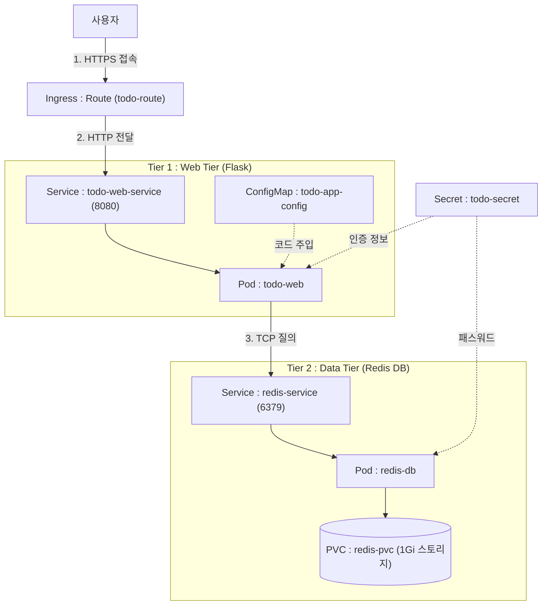
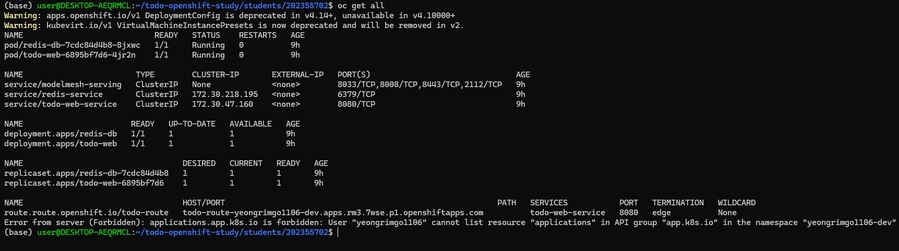
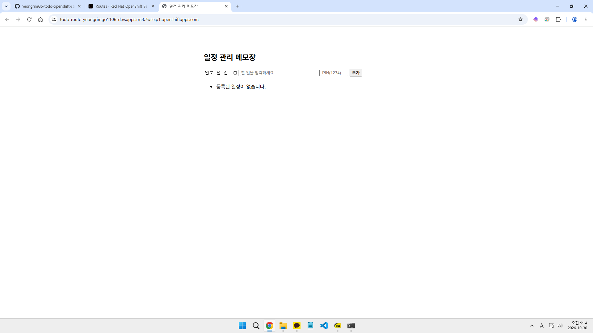

# 컨테이너 실습 보고서

---

## 1. 컨테이너 소개

- **서비스 이름**: 일정 관리 메모장
- **한 줄 설명**: Python Flask 웹 프론트엔드와 Redis In-Memory DB를 결합하여 일정을 등록하고 관리하는 2-Tier 웹 애플리케이션
- **이 주제를 고른 이유**:
  - **2-Tier 아키텍처 학습**: 웹 프론트엔드(Web)와 데이터베이스(DB)로 계층을 분리하여 클러스터 내부 서비스와 파드 간 통신 흐름을 실습할 수 있습니다.
  - **다양한 OpenShift 리소스 활용**: `ConfigMap`(코드 및 환경설정 분리), `Secret`(시크릿 주입), `PVC`(데이터 영속화), `Route`(TLS 라우팅) 등 플랫폼의 오브젝트를 골고루 다뤄볼 수 있습니다.
  - **경량성 및 직관적인 검증**: 디벨로버 샌드박스 환경에 맞게 경량이고, 브라우저 UI와 `/healthz` 엔드포인트를 통해 즉각적으로 동작 상태를 검증할 수 있습니다.
- **주요 기능**:
  - **일정 등록 및 조회**: 날짜(`date`)와 할 일(`task`)을 입력받아 Redis의 리스트(`LPUSH`, `LRANGE`)에 실시간으로 저장 및 화면 렌더링
  - **간이 관리자 PIN 인증**: 일정 등록 시 사전에 정의된 관리자 PIN(`ADMIN_PIN`) 검증을 거쳐 인가된 사용자만 일정을 추가하도록 제어
  - **데이터 영속성 보장**: Redis 데이터 디렉터리를 PVC(`redis-pvc`)에 마운트하여 파드가 재시작되거나 재배포되어도 데이터 보존
  - **헬스 체크(Health Check)**: 컨테이너 상태 모니터링 및 무중단 배포를 위한 `/healthz` 엔드포인트 제공

---

## 2. 아키텍처

### 2.1 구성도 (Mermaid)



### 2.2 사용자 → Route → Service → Pod 흐름

1. **사용자 접속 (User → Route)**: 사용자가 웹 브라우저를 통해 URL로 접속합니다. OpenShift Router가 요청을 받아 **Edge TLS termination**(SSL 복호화)을 수행합니다.
2. **웹 서비스 라우팅 (Route → Service)**: 복호화된 HTTP 트래픽이 8080 포트를 통해 내부 서비스로 전달됩니다.
3. **웹 파드 로드밸런싱 (Service → Pod)**: `todo-web-service`가 레이블 셀렉터(`app: todo-web`)를 통해 활성화된 `todo-web` 파드로 요청을 포워딩합니다.
4. **비즈니스 로직 및 DB 쿼리 (Pod → Service → Pod)**:
   - Flask 웹 애플리케이션은 사용자가 입력한 요청을 해석합니다.
   - 내부 DNS 서비스 이름인 `redis-service:6379`로 TCP 연결을 요청하고, `todo-secret`에서 전달받은 `REDIS_PASSWORD`로 인증한 후 Redis 명령어를 실행합니다.
5. **데이터 영속화 (Pod → PVC)**:
   - `redis-db` 파드는 영속 볼륨 클레임(`redis-pvc`)으로 마운트된 `/var/lib/redis/data` 디렉터리에 데이터를 기록하여 파드가 재시작되어도 유실되지 않도록합니다.

### 2.3 사용한 Object 목록과 각 역할 
('매니페스트 위치'는 /students/202355702/k8s를 기준으로 합니다)

| Object 종류 | 리소스 이름 | 매니페스트 위치 | 주요 역할 및 세부 설명 |
|---|---|---|---|
| **Route** | `todo-route` | [`route-todo-route.yaml`] | OpenShift 전용 인그레스 객체. 클러스터 외부 도메인 트래픽을 Edge TLS로 안전하게 수신하여 `todo-web-service`의 8080 포트로 라우팅 |
| **Service** | `todo-web-service` | [`service-todo-web-service.yaml`] | `todo-web` 파드들에 고정된 내부 가상 IP(ClusterIP: 8080)를 제공하고 내부 부하 분산 수행 |
| **Deployment** | `todo-web` | [`deployment-todo-web.yaml`] | UBI9 Python 기반 Flask 웹 컨테이너의 복제본 및 무중단 롤링 업데이트 라이프사이클 관리 |
| **Service** | `redis-service` | [`service-redis-service.yaml`] | `redis-db` 파드에 클러스터 내부 도메인 이름(`redis-service:6379`)을 제공하여 웹 파드가 DB를 탐색할 수 있도록 지원 |
| **Deployment** | `redis-db` | [`deployment-redis-db.yaml`] | RHEL9 Redis 컨테이너의 파드 생성 및 상태를 관리 |
| **PersistentVolumeClaim** | `redis-pvc` | [`persistentvolumeclaim-redis-pvc.yaml`] | AWS EBS로부터 1Gi 크기의 볼륨을 할당받아 `/var/lib/redis/data`에 마운트하여 데이터 영속성 유지 |
| **ConfigMap** | `todo-app-config` | [`configmap-todo-app-config.yaml`] | 애플리케이션의 소스코드(`app.py`)와 UI 타이틀(`APP_TITLE`)을 컨테이너 외부에서 주입 |
| **Secret** | `todo-secret` | [`secret-todo-secret.yaml`] | Redis 인증 암호(`REDIS_PASSWORD`) 및 일정 등록 PIN(`ADMIN_PIN`) 등 민감 정보를 보관하여 안전하게 환경변수로 주입 |

---

## 3. 사용 이미지

### 3.1 Web 컨테이너 이미지

- **이미지 주소 및 태그**: `registry.redhat.io/ubi9/python-312:9.8-1793254183`
- **선택한 이유**:
  - Red Hat의 공식 UBI 9 기반으로 엔터프라이즈급 안정성과 정기적인 보안 패치가 보장됩니다.
  - 안정 버전인 Python 3.12 런타임을 탑재하고 있는 이미지라 Flask 프레임워크와의 호환성이 뛰어납니다.
  - OpenShift의 기본 보안 제약 조건(SCC, Security Context Constraints)인 임의의 비루트(Non-root) UID 실행 환경을 완벽하게 지원합니다.
- **노출 포트**: `8080/TCP` (비루트 사용자가 바인딩 가능한 표준 애플리케이션 포트)

### 3.2 DB 컨테이너 이미지

- **이미지 주소 및 태그**: `registry.redhat.io/rhel9/redis-7:9.8-1793253232`
- **선택한 이유**:
  - Red Hat의 엔터프라이즈 리눅스를 기반으로 엔터프라이즈급 안정성과 정기적인 보안 패치가 보장됩니다.
  - 컨테이너 기동 시 `REDIS_PASSWORD` 환경변수 주입만으로 패스워드 인증 활성화 및 데이터 디렉터리 권한이 자동 초기화되어 설정이 간결합니다.
  - OpenShift 환경에 최적화된 파일시스템 권한(`redis:root`)이 구성되어 있어 PVC 마운트 시 권한 충돌이 발생하지 않습니다.
- **노출 포트**: `6379/TCP` (Redis 표준 포트)

---

## 4. 배포 방법

### 4.1 배포 명령

OpenShift CLI(`oc`)를 사용하여 매니페스트 파일들을 일괄 적용합니다:

```bash
# 매니페스트 디렉터리 일괄 배포
oc apply -f students/202355702/k8s/
```

### 4.2 배포 후 확인 방법

#### 1) 파드 실행 상태 확인
```bash
oc get pods -w
```
- 모든 파드(`todo-web-*`, `redis-db-*`)의 상태가 `Running` 및 `1/1 READY`가 되는지 확인합니다.

#### 2) 접속 URL(Route Host) 확인
```bash
oc get route todo-route -o jsonpath='{.spec.host}{"\n"}'
```
- 출력된 호스트명을 확인합니다.

#### 3) 접속 경로 및 예상 화면/응답
- **접속 경로**: 출력된 공개 URL
- **예상 화면**:
  - 브라우저에 접속 시 상단에 ConfigMap에 설정된 타이틀 **"일정 관리 메모장"** 표시
  - 날짜 선택창, 할 일 입력 텍스트 필드, PIN 입력 필드(`1234`), [추가] 버튼 노출
  - PIN 번호를 올바르게 입력 후 [추가] 시 목록에 `[YYYY-MM-DD] 입력한 할 일` 항목이 정상 등록 및 출력
- **헬스 체크 응답**:
  ```bash
  curl -k <공개된 URL>
  # 응답: OK (HTTP 상태코드 200)
  ```

---

## 5. 배포 결과

### 5.1 `oc get all` 출력 결과



### 5.2 브라우저 접속 화면

- **웹 브라우저 접속 화면**:
  일정 관리 메모장 웹 페이지가 정상적으로 로드되며 날짜, 할 일, PIN 입력 폼이 표시된 결과 화면입니다.



---

## 6. 어려웠던 점 (오류 및 해결 과정)

### 1) 적합한 이미지 탐색
- **발생한 문제**: 명확하게 오류가 발생한 것은 아니지만, 많은 선택지가 주어지고 저장소 자체 검색기능에 미숙하다보니 설계한 애플리케이션 구성에 필요한 이미지를 탐색하는 과정에서 어려움을 겪었습니다.
- **해결 과정**:
  - 필요한 파이썬 런타임만 존재하는 이미지를 선택해 ConfigMap으로 간단한 소스코드를 주입하는 방식으로 구현했습니다.

### 2) 웹 콘솔에서 자동 생성된 항목 제거
- **발생한 문제**: 웹 콘솔에서 자동 생성된 yaml 파일을 다운로드 받다보니 런타임 종속적인 자동생성 항목이 다양하게 존재했습니다. 어떤 항목이 런타임 종속적이라 삭제가 필요하고, 어떤 항목이 배포에 반드시 필요한 항목인지 구분하는 과정에서 어려움을 겪었습니다.
- **해결 과정**:
  - AI 도구를 활용해 일괄적으로 자동생성된 항목들을 제거하고, 삭제된 항목들, 남은 항목들을 구분하여 이에 대한 보고서를 작성하여 학습에 활용했습니다.

### 3) Pod Readiness, Liveness Probe 설정 문제
- **발생한 문제**: Deployment가 아닌 각 Pod 마다 probe를 정의하려고 하니 명확하게 파악하지 못한 원인으로 Pod가 CrashLoopback에 빠지거나 가동 순서에 따라 가동이 되지 않는 등의 문제가 발생했습니다.
- **해결 과정**:
  - 오류가 발생한 Pod들마다 로그를 확인하고, 초기 대기시간을 늘리거나 탐지 인터벌을 늘리는 형식으로 대응했습니다.
  - 그러나 의존성 있는 리소스들끼리 가동 순서에 따라 여전히 Pod가 CrashLoopback에 빠지는 등의 문제가 남아있었습니다.
  - 각 Deployment 리소스를 감시하는 것으로 바꾸어 probe를 설정하니 문제없이 배포되었습니다.

### 4) oc get all 명령어 실행시 deprecated 발생
- **발생한 문제**: oc get all 명령어 실행시 DeploymentConfig, VirtualMachineInstancePresets 리소스가 deprecated 된 구버전이라는 메시지가 출력되었습니다.
- **해결 과정**:
  - 먼저 yaml 파일들을 전수 조사하여 해당 리소스 타입이 사용된 곳을 탐색하였으나 발견하지 못했습니다.
  - 검색을 통해 원인 파악을 시도하여 해당 오류가 oc get all 명령어 실행시 사전정의된 모든 리소스 타입들을 조회하는 과정에서 이미 deprecated 된 리소스 종류를 가진 리소스가 있는지 조회하여 발생하는 메시지라는 사실을 알게되어 별도 조치 없이 진행했습니다.

---

## 7. AI·참고자료 활용 내역

### 7.1 사용한 AI 도구 및 용도
- **사용한 도구**: Antigravity CLI
- **활용 용도**:
  - Flask 간이 웹 메모장 코드 및 HTML 인라인 템플릿 작성
  - YAML 파일 웹콘솔 자동생성 항목 제거
  - Mermaid를 활용한 클라우드 아키텍처 다이어그램 작성

### 7.2 참고한 공식 문서 링크
- **Red Hat Ecosystem Catalog (빌더 이미지)**:
  - [Python 3.12 컨테이너 이미지 상세 중 get this image](https://catalog.redhat.com/en/software/containers/ubi9/python-312/657b08d023df896ebfacf402)
  - [Redis 7 컨테이너 이미지 상세 중 get this image](https://catalog.redhat.com/en/software/containers/rhel9/redis-7/64881353e0e10aaf1cbac8b7)